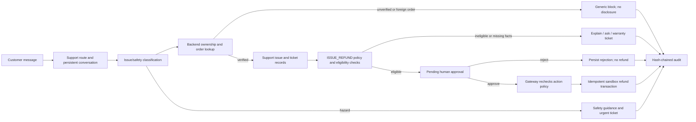

# AgentShield Architecture & Security Design

> Scope note: this repository is a local demonstration. Authentication and external commerce/payment providers are simulated or unconfigured. The customer support workflow below is deterministic; no live language model is needed for its core decisions.

AgentShield is an enterprise-grade runtime security, authorization, and control platform for autonomous AI agents.

## Core Principle
> **"No protected operation may execute merely because an AI model requested it."**

The language model operates strictly in the untrusted proposal zone. All business mutations, data queries, and API calls require deterministic authorization by trusted backend code.

---

## 1. High-Level Architecture Flow

```
   [ User Voice / Text Input ]
                 │
                 ▼
   ┌───────────────────────────┐
   │    Voice Pipeline (STT)   │  ◄── Gnani Prisma v2.5 (Telephonic ASR) / Mock
   └─────────────┬─────────────┘
                 │ (Transcript text)
                 ▼
   ┌───────────────────────────┐
   │  Intent Proposal Extractor│  ◄── Strict Zod Schemas + Gnani Evon / Fallback
   └─────────────┬─────────────┘
                 │ (Structured Action Proposal)
                 ▼
   ┌─────────────────────────────────────────────────────────────┐
   │            Deterministic Policy Engine (P0)                 │
   │  • Tenant & Account Boundary Isolation                       │
   │  • Agent Role-Based Access Control (RBAC)                   │
   │  • Action Ceiling Limits ($10,000 max single transfer)      │
   │  • Tiered Step-Up Verification Thresholds ($1,000 threshold)│
   │  • Data Exfiltration Interceptor                            │
   └─────────────┬───────────────────────────────────────────────┘
                 │
       ┌─────────┴─────────┐
       ▼                   ▼
   [ DENY ]            [ VERIFY ] ──────────────► [ Single-Use Bound Challenge ]
       │                   │                                 │
(Action Blocked)   (Execution Halted)                        ▼
                           │                      [ OTP Verification Submit ]
                           │                                 │
                           │                      (Parameter Tampering Check)
                           │                                 │
                           └─────────────────┬───────────────┘
                                             ▼
                                         [ ALLOW ]
                                             │
                                             ▼
                               ┌───────────────────────────┐
                               │ Protected Business APIs   │
                               │ • Atomic DB Transactions  │
                               │ • Idempotency Protection  │
                               └─────────────┬─────────────┘
                                             │
                                             ▼
                               ┌───────────────────────────┐
                               │ SHA-256 Chained Audit Log │
                               │ • Tamper-evident blocks   │
                               └───────────────────────────┘
```

---

## 2. Core Architectural Subsystems

## 3. Customer support workflow



The `support_conversations`, `support_messages`, `support_issues`, `support_tickets`, and `refund_approval_requests` tables persist the support process. Orders carry purchase, delivery, and payment fields. Seed data deliberately includes an eligible recent order, an expired order, a refunded order, an in-transit order, and an order with disputed delivery.

The refund policy is the seeded `ISSUE_REFUND` row. It contains `returnWindowDays`, `maxSingleAmount`, `stepUpThreshold`, and `humanApprovalThreshold`. Verified product SKUs, categories, returnability, and warranty duration live in `support_products`. Product support issues must be recorded before the conversation can queue a refund; the legacy refund proposal endpoint is denied without one. The admin review endpoint checks the server-owned demo role, claims a pending request, revalidates paid/delivered ownership through the policy gateway, and uses an idempotency key when executing the local refund. These sample policies are not universal business or legal rules.

The support classifier and troubleshooting responses are rule based, not LLM reasoning. Safety language escalates without repair instructions. The customer-facing chat cannot mark a request approved, set its owner, or supply order facts; backend identity and database records control those decisions.

### A. Typed Action Registry
- Located in `server/src/registry/actions.js` & `server/src/registry/schemas.js`.
- Implemented with strict **Zod** schema validation.
- Registered actions:
  - `READ_BALANCE`: Risk Level `LOW`. Required permission `accounts:read`.
  - `TRANSFER_FUNDS`: Risk Level `HIGH`. Required permission `transfers:execute`.
  - `REQUEST_REFUND`: Risk Level `MEDIUM`. Required permission `refunds:execute`.
  - `UPDATE_PREFERENCE`: Risk Level `LOW`. Required permission `preferences:write`. Injected sensitive fields (e.g., daily limit, roles) strictly rejected via `.strict()`.
  - `EXPORT_CUSTOMER_DATA`: Risk Level `CRITICAL`. Required permission `data:bulk_export` (denied to conversational agents).

### B. Deterministic Policy Engine
- Located in `server/src/policy/engine.js`.
- Evaluates actions against explicit enterprise rules, independent of LLM opinion.
- Decisions:
  - **`ALLOW`**: Fully compliant with limits and permissions. Proceeds to atomic execution.
  - **`VERIFY`**: Exceeds automated thresholds or involves unverified recipients. Halts execution and issues cryptographically bound challenge.
  - **`DENY`**: Violates system policy ceilings, tenant boundaries, or permissions. Produces ZERO state mutations.

### C. Step-Up Verification & Cryptographic Parameter Binding
- Located in `server/src/verification/challengeService.js`.
- Single-use 6-digit challenge code bound to canonical parameter hash:
  $$\text{Hash} = \text{SHA-256}(\text{accountId} \parallel \text{recipientId} \parallel \text{amount})$$
- **Parameter Tampering Guard:** If an attacker receives an OTP for $1,200 and modifies the execution amount to $9,000, the hash mismatches immediately. The operation is aborted, and the challenge is permanently invalidated.
- **Single-Use Semantics:** Once consumed, the challenge state transitions to `CONSUMED`. Replay attempts fail.

### D. Cryptographic Audit Trail (Hash Chain)
- Located in `server/src/audit/auditLogger.js` and `server/src/audit/hashChain.js`.
- Every audit record contains:
  $$\text{Block}_{n} = \text{SHA-256}(\text{id} \parallel \text{timestamp} \parallel \text{requestId} \parallel \text{eventType} \parallel \text{decision} \parallel \text{reasonCode} \parallel \text{payload} \parallel \text{Block}_{n-1})$$
- Verifiable via `/api/audit/verify-chain`.
- **What it detects:** Post-hoc SQL record modification, record insertion, record deletion, reordering.
- **What it cannot prevent:** Total physical database disk destruction if root OS access is compromised.

### E. Gnani Voice Integration & Credit Budget Guard
- Located in `server/src/providers/budgetGuard.js` & `server/src/providers/gnani/`.
- **Verified Gnani Specifications:**
  - Base URL: `https://api.vachana.ai`
  - Auth: `X-API-Key-ID` header
  - Prisma v2.5 STT: `POST /stt/v3` (Telephonic 8kHz / 16kHz speech recognition)
  - Timbre v2.5 / v3.0 TTS: `POST /api/v1/tts` / WebSocket (Expressive Indic & English speech)
  - Evon v3.3: 30B parameter reasoning model
- **Conservative Budget Guard:**
  - Default: `GNANI_ENABLED=false` (Safe mock default).
  - Credit Budget: 5,000 credits.
  - Safety Reserve: 1,000 credits.
  - Usable Quota: 4,000 credits.
  - Hard cutoff: Automatically blocks live requests when reserve is reached.
  - Zero background calls on startup, tests, or heartbeat.
